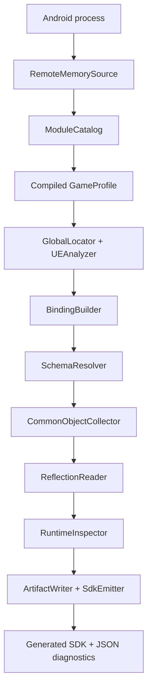

# AndUEFker

> A runtime Unreal Engine reflection and SDK generation tool for Android.

[](https://isocpp.org/)
[](https://cmake.org/)
[](https://developer.android.com/)
[](https://choosealicense.com/licenses/mit/)
[](https://github.com/Ezeny1337/AndUEFker/releases/)

[中文文档](README_zh.md)

AndUEFker discovers Unreal Engine runtime structures from a live Android process, validates the object and name stores, resolves the reflection schema, and generates C++ descriptions and machine-readable reflection metadata for developers and reverse engineering tools.

Rather than relying on a single hardcoded layout, it combines binary analysis, runtime probing, cross-validation, and reflection data to establish verified runtime bindings prior to reading the object graph.

Build the tool with the ABI matching the target process: use the `arm64-v8a` binary for 64-bit games and the `armeabi-v7a` binary for 32-bit ARM games.

## Highlights

- **Runtime-first binding** — locates and validates `GUObjectArray`, `ObjObjects`, and `FName` storage at runtime.
- **Schema discovery** — resolves `UObject`, `UStruct`, `FField`/`FProperty`, `UFunction`, and `UEnum` layouts from live data.
- **ARM-aware analysis** — supports ARM64 and ARM32 ARM-mode decoding for Unreal Android binaries; Thumb/Thumb-2 analysis remains a separate follow-up.
- **Reflection extraction** — walks live Unreal objects and emits types, properties, functions, enums, inheritance, and layout metadata.
- **IDA import** — imports reflected type descriptions and annotates validated in-module execution-entry RVAs.
- **Common class addresses** — records useful `UClass` objects such as `World`, `Engine`, `GameInstance`, and `PlayerController`.
- **Traceable artifacts** — writes generated headers, JSON metadata, diagnostics, runtime bindings, and producer identity as one artifact directory.
- **Fail-closed validation** — invalid candidates and inconsistent layouts are rejected rather than silently treated as valid.
- **Bounded capture** — rechecks consumed bytes and covers object-array growth through limited tail enumeration.
- **Read-only instance evidence** — samples container contents, weak references, text headers, and delegate bindings with independent stability checks.

## Pipeline



The runtime session follows these stages:

1. Attach to the target process and discover the Unreal module.
2. Select the unique compiled game profile matching the package and module; use identity decoding when none matches.
3. Collect object/name root candidates from ELF symbols, profiles, and UEAnalyzer.
4. Validate object and name stores with profile decoders and optional layout hints.
5. Probe engine schema profiles and validate the runtime reflection layout.
6. Collect common `UClass` objects and read validated reflection definitions.
7. Collect bounded instance evidence, publish the SDK, and write a separate compatibility diagnosis.

Schema profiles cover UE 4.23–4.27 and 5.0–5.6 layout families. Selection records the validated runtime layout, compatible profiles, and engine-version confidence; profile coverage does not guarantee every engine branch or build configuration.

## Game Profiles and Compatibility Diagnosis

Compiled profiles are the current extension point for game-specific adaptation. Derive an `IGameProfile` defined in `include/anduefker/compat/GameProfile.hpp` and register it in `src/compat/GameProfiles.cpp`. With no matching profile, the existing automatic discovery and identity decoding path remains active.

A minimal profile shape is shown below. The class can live in a separate header included by `GameProfiles.cpp` and be added to `CreateGameProfiles()`; if it needs a separate `.cpp`, add that source to `CMakeLists.txt`:

```cpp
class ExampleGameProfile final : public anduefker::compat::IGameProfile
{
public:
    std::string_view Id() const override { return "example-game"; }

    bool Matches(std::string_view packageName,
                 const anduefker::module::ModuleImage &module) const override
    {
        return packageName == "com.example.game" && module.pointerWidth == 8;
    }

    anduefker::binding::DecodePlan MakeDecodePlan(
        const anduefker::memory::IMemorySource &,
        const anduefker::module::ModuleImage &) const override
    {
        auto decode = anduefker::binding::DecodePlan::Identity();
        // 只覆盖已通过目标样本验证的字段解码器。
        return decode;
    }
};
```

Add the class to `CreateGameProfiles()`. `Matches()` should check the package, target ABI, and module name where possible; each runtime stage accepts the profile only after its probes pass.

| Adaptation layer | Profile capability | Validation and diagnostic boundary |
| --- | --- | --- |
| Process, memory access, and module discovery | Not overridden by game profiles | Failures are runtime blockers; compatibility is not evaluated. |
| Global root location and pointer chains | `LocateRoots()` returns additional object/name root candidates | Candidates still require layout and semantic validation; an unresolved root does not prove encryption. |
| Object/name container layout | `LayoutHints()` can supply one object/name layout hint | A hint replaces automatic discovery for that container but still goes through runtime probes. |
| Object and name field decoding | `MakeDecodePlan()` configures pointer, count, index, `FName` number, header, and related decoders | Decoded values must still pass object-index, name-sentinel, and other checks. |
| Name text | `DecodePlan::nameText` can decode raw UTF-8/UTF-16 bytes | The same callback is used by layout discovery, probes, and actual reads. |
| Unreal reflection schema | Built-in `SchemaResolver` probes supported UE layout families | Game profiles cannot currently override arbitrary vendor-modified reflection schemas; extend this only when a real case requires it. |

`Matches()` should use explicit package and module/ABI conditions. Module identity is not a content hash, so a package-name match alone cannot prove that the target binary is identical to the reverse-engineered sample. Profiles receive only the read-only `IMemorySource` interface. Decoder callbacks are retained with the profile and binding for the lifetime of `RuntimeSession`; do not capture short-lived objects.

Each run attempts to write `AndUEFker_<timestamp>.diagnosis.json` to the output directory, including when it stops before binding or schema resolution. The report includes the package, module, architecture, and pointer width; it separates runtime outcome from compatibility assessment and provides stable finding domains, codes, stages, confidence, summaries, and next actions:

- Process, memory-access, module, or output failures are reported as runtime findings. Compatibility remains `not-evaluated` or retains a conclusion already reached.
- Without a profile, failed root binding is reported as `ROOT_BINDING_NOT_VALIDATED`. This points to root, layout, or decoding validation; it does not claim encryption was detected.
- A selected profile that fails validation is reported as `profile-validation-failed`, with the failed stage and suggested inspection points.
- A complete no-profile binding/schema/reflection path is `baseline-compatible`; a complete profile path is `profile-validated`.
- Exceptions from profile decoders are reported separately. During binding, the tool retries with identity decoding; in later stages it stops before publishing untrusted results.

The diagnosis provides evidence-based investigation targets. It does not infer vendor algorithms or label a layout difference or ordinary runtime failure as encryption.

## Build

### Requirements

- Android SDK with platform `android-29` or compatible.
- Android NDK `25.2.9519653` for the repository CI configuration.
- CMake `3.22.1` for the repository CI configuration.
- Ninja.
- A host environment capable of building Android `arm64-v8a` and `armeabi-v7a` code.

### Build script

`build.sh` wraps the Android toolchain configuration and enables ThinLTO. It supports three modes:

| Mode | Configuration | Purpose |
| --- | --- | --- |
| `verify` | Release, ThinLTO, no size-specific optimization | Fast compile verification; default mode. |
| `release` | Release, `-Oz`, ThinLTO, without `NDEBUG`, stripped | Small distributable binary. |
| `debug` | Debug symbols, ThinLTO, with `NDEBUG` | Debuggable binary. |

Set `ANDROID_NDK_HOME` (or `ANDROID_NDK_ROOT`) before running the script. If only `ANDROID_SDK_ROOT` is set, the script discovers the newest installed NDK.

```bash
chmod +x build.sh

# Fast compile verification, arm64-v8a by default.
./build.sh

# Size-optimized release binary.
./build.sh --mode release --abi arm64-v8a

# Debug-symbol binary with NDEBUG enabled.
./build.sh --mode debug --abi armeabi-v7a --jobs 4
```

Script builds produce `build/android-<abi>-<mode>/AndUEFker` by default. Use `--build-dir` to override the build directory or `--no-strip` to retain release symbols.

### Direct CMake configuration

The following is the same toolchain shape used by the GitHub Actions workflow:

```bash
cmake -S . -B build/android-arm64-release -G Ninja \
  -DCMAKE_TOOLCHAIN_FILE="$ANDROID_NDK_HOME/build/cmake/android.toolchain.cmake" \
  -DANDROID_ABI=arm64-v8a \
  -DANDROID_PLATFORM=android-29 \
  -DANDUEFKER_ENABLE_THINLTO=ON \
  -DCMAKE_BUILD_TYPE=Release

cmake --build build/android-arm64-release --parallel
```

The executable is produced at:

```text
build/android-arm64-release/AndUEFker
```

## Usage

```text
AndUEFker -o <output-dir> -p <package-name>
```

Run the tool on the Android device while the target process is running. It requires permission to read the target process memory and write the output directory; it does not bypass platform access restrictions.

### Required options

| Option | Description |
| --- | --- |
| `-o`, `--output <dir>` | Writable directory for logs and the generated SDK artifact. |
| `-p`, `--package <name>` | Android package name of the target process. |

### Optional option

| Option | Description |
| --- | --- |
| `-h`, `--help` | Print command-line help. |

### Example

```bash
./AndUEFker \
  --output /storage/emulated/0/AndUEFker-output \
  --package com.example.game
```

## Generated artifact

If the package name is `com.example.game`, a successful run creates an artifact directory similar to:

```text
<output-dir>/com_example_game_YYYYMMDDHHMMSS/
├── BasicTypes.hpp
├── EngineLayouts.hpp
├── Types.hpp
├── Enums.hpp
├── Functions.hpp
├── reflection.json
├── manifest.json
├── diagnostics.json
└── runtime.json
```

The directory name ends with the same local timestamp (year to second) as the session log and diagnosis file, so one run produces one identifiable artifact set.

The output directory also receives the session log:

```text
<output-dir>/AndUEFker_YYYYMMDDHHMMSS.log
<output-dir>/AndUEFker_YYYYMMDDHHMMSS.diagnosis.json
```

The timestamp (year to second) is generated at session start in local time, so each run attempts to write its own log and compatibility diagnosis. Stage findings are retained even if the run fails before SDK artifact generation. If an artifact directory with the same name already exists, it is replaced: the old directory is removed first and the new one is committed from a temporary directory.

The `.diagnosis.json` file provides stable stage and finding codes. `session_status` describes Dumper execution, `compatibility_status` describes target compatibility, and `profile_status` describes whether the selected profile was activated and validated; they are independent results.

### Generated files

| File | Purpose |
| --- | --- |
| `BasicTypes.hpp` | SDK primitives, typed opaque storage, and source-backed layout tags. |
| `EngineLayouts.hpp` | Runtime-resolved offsets for selected Unreal reflection structures; `-1` marks unresolved offsets. This is not a complete native C++ ABI layout. |
| `Types.hpp` | Reflected Unreal classes and structs with identities and target layout information. |
| `Enums.hpp` | Reflected enum declarations and values. |
| `Functions.hpp` | Reflected execution-entry RVAs and parameter layouts. |
| `reflection.json` | Reflection IR, generation metadata, storage models, and bounded runtime evidence. |
| `manifest.json` | Artifact status, parsing statistics, and producer provenance. |
| `diagnostics.json` | Reflection and generation diagnostics, counters, and shared evidence references. |
| `runtime.json` | Runtime module, binding layout, schema offsets, and common object addresses. |

The generated headers use the `AndUE` namespace and describe target memory for developer inspection, game tooling, and analysis in IDA/Ghidra. Reflected sizes, offsets, masks, and references are authoritative; C++ declarations are descriptions of the target layout.

The SDK is not a directly callable runtime library. Native C++ ABI compatibility is not asserted; use reflected metadata rather than `sizeof`/`offsetof`. Execution-entry RVAs are not guaranteed to identify original C++ business implementations.

Generation metadata separates semantic declarations from storage descriptions and identifies delegate forms; diagnostics reference shared reflection evidence.

### IDA import

Run `tools/ida/anduefker_import.py` from IDA and select an AndUEFker artifact directory. The importer writes `AndUEFker_IDA_types.h` beside the artifact, imports reflected byte-layout types into IDA's local type library, and annotates eligible in-module execution-entry RVAs with names and repeatable comments. It does not apply runtime heap addresses to the static image or create functions automatically. Enum declarations with values outside the 32-bit C enum range are left in `reflection.json` and omitted from the generated IDA header.

The artifact does not contain a hash of the target image. Confirm that the IDA input is the exact binary used for the capture before applying RVA annotations.

## Common object addresses

The runtime artifact can contain the following commonly used `UClass` objects:

```text
World
Engine
GameInstance
LocalPlayer
PlayerController
GameViewportClient
Console
CheatManager
```

These are class-object addresses discovered in the Unreal object store. They are not automatically the addresses of live instances such as the current `GWorld`, `GEngine`, or a current player controller instance.

## Validation and status

AndUEFker records evidence during binding, schema resolution, reflection capture, and SDK generation, including:

- object and name candidate counts;
- selected container layouts and probe scores;
- resolved UObject and reflection offsets;
- object slot and reflection statistics;
- unknown properties, unresolved type details, layout conflicts, and read failures.

Artifact status uses the following states; published artifacts record their status in `manifest.json`:

| State | Meaning |
| --- | --- |
| `Complete` | Reflection reading and SDK descriptions are complete; all required files were written and closed. |
| `Partial` | Reflection reading or SDK descriptions have limitations; the artifact is marked `.partial` before the directory timestamp. |
| `Failed` | Binding, schema resolution, reflection, or artifact writing failed; an artifact or manifest may not be available. |

The command-line process exits with `0` for a complete artifact, `3` for partial reflection reading or SDK descriptions, `2` for invalid command-line arguments, and `1` for other failures or incomplete runtime stages.

`manifest.json` records `reflection_status` and `sdk_status` separately. Typed opaque storage preserves known field semantics and sizes; selected heap and MemoryImage container layout tags describe target offsets, not universally validated live traversal. Opaque storage does not by itself make the SDK description partial. Omitted fields and description layout warnings do.

JSON artifacts retain complete field metadata. Logs retain diagnostic summaries, bounded normal samples, and anomalies, with omitted sample counts and artifact references.

Value-storage descriptions use source-backed layout candidates across UE4.23–5.6, not version-only guesses. Optional read-only instance evidence is bounded and independently checked; unavailable values do not reduce SDK completeness or imply native ABI compatibility.

Capture stability is not an atomic snapshot, and `scan_complete` covers object-slot enumeration, not all fields or values. FText evidence describes outer storage, not arbitrary display strings. Sparse binding inspection requires a located storage root and compatible layout candidates; frozen element layouts and remote object resolution may remain unverified.

## Issues

Please open an [issue](https://github.com/Ezeny1337/AndUEFker/issues) when you encounter a reproducible detection, binding, schema, reflection, or artifact-generation problem. Include:

1. The commit or release used.
2. Android version, device ABI, and target Unreal Engine information if known.
3. The command line with package names or sensitive values redacted where necessary.
4. The relevant section of the timestamped `AndUEFker_*.log` session log.
5. `manifest.json`, `diagnostics.json`, and `runtime.json` when available.
6. A concise reproduction description and the expected result.

Before uploading logs or artifacts, remove credentials, private binaries, proprietary assets, and any information that you are not authorized to share. Large generated `reflection.json` files can be attached separately or summarized with the relevant object and schema records.

## Disclaimer

AndUEFker is provided for authorized research, debugging, interoperability, and development purposes. You are responsible for obtaining permission to inspect the target process and for complying with applicable laws, licenses, platform rules, and software terms of service. Runtime layouts vary between engine versions, forks, build configurations, and shipping processes; successful binding does not guarantee that every generated field or function is complete or safe for production use. The project is provided without warranties, and the maintainers are not responsible for damage, data loss, service disruption, or misuse resulting from its use.

## License

    MIT License

    Copyright (c) 2026 Ezeny1337

    Permission is hereby granted, free of charge, to any person obtaining a copy
    of this software and associated documentation files (the "Software"), to deal
    in the Software without restriction, including without limitation the rights
    to use, copy, modify, merge, publish, distribute, sublicense, and/or sell
    copies of the Software, and to permit persons to whom the Software is
    furnished to do so, subject to the following conditions:

    The above copyright notice and this permission notice shall be included in all
    copies or substantial portions of the Software.

    THE SOFTWARE IS PROVIDED "AS IS", WITHOUT WARRANTY OF ANY KIND, EXPRESS OR
    IMPLIED, INCLUDING BUT NOT LIMITED TO THE WARRANTIES OF MERCHANTABILITY,
    FITNESS FOR A PARTICULAR PURPOSE AND NONINFRINGEMENT. IN NO EVENT SHALL THE
    AUTHORS OR COPYRIGHT HOLDERS BE LIABLE FOR ANY CLAIM, DAMAGES OR OTHER
    LIABILITY, WHETHER IN AN ACTION OF CONTRACT, TORT OR OTHERWISE, ARISING FROM,
    OUT OF OR IN CONNECTION WITH THE SOFTWARE OR THE USE OR OTHER DEALINGS IN THE
    SOFTWARE.
