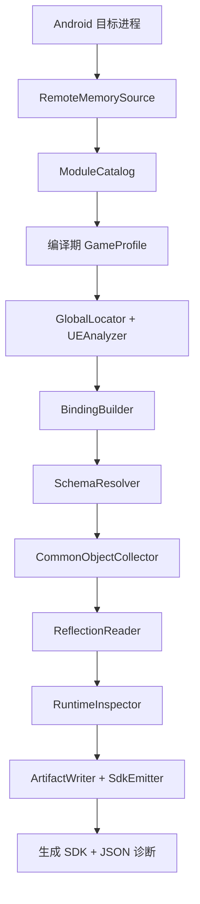

# AndUEFker

> 面向 Android 的 Unreal Engine 运行时反射与 SDK 生成工具。

[](https://isocpp.org/)
[](https://cmake.org/)
[](https://developer.android.com/)
[](https://choosealicense.com/licenses/mit/)
[](https://github.com/Ezeny1337/AndUEFker/releases/)

[English](README.md)

AndUEFker 可以从正在运行的 Android 进程中发现 Unreal Engine 的运行时结构，验证对象表与名称存储，解析反射 Schema，并为开发者和逆向分析工具生成 C++ 描述及机器可读的反射元数据。

它不依赖单一硬编码布局，而是结合二进制分析、运行时探针、交叉验证和反射数据，在读取对象图之前先建立经过验证的运行时绑定。

工具 ABI 需要与目标进程匹配：64 位游戏使用`arm64-v8a`版本，32 位 ARM 游戏使用`armeabi-v7a`版本。

## 核心能力

- **运行时绑定** — 运行时定位并验证 `GUObjectArray`、`ObjObjects` 与 `FName` 存储。
- **Schema 自动解析** — 从实时数据中解析 `UObject`、`UStruct`、`FField`/`FProperty`、`UFunction` 和 `UEnum` 布局。
- **ARM 架构分析** — 支持 ARM64 和 ARM32 ARM-mode 指令解码，以及面向 Unreal 二进制的候选地址分析策略；Thumb/Thumb-2 暂未支持。
- **反射提取** — 遍历 Unreal 运行时对象，输出类型、属性、函数、枚举、继承关系和布局元数据。
- **IDA 导入** — 导入反射类型描述，并为已验证的模块内执行入口 RVA 添加标注。
- **常用类地址收集** — 记录 `World`、`Engine`、`GameInstance`、`PlayerController` 等常用 `UClass` 对象地址。
- **可追溯产物输出** — 将生成头文件、JSON 元数据、诊断、运行时绑定及生成器身份写入统一产物目录。
- **验证失败即拒绝** — 对无效候选和不一致布局进行拒绝，避免静默使用错误结果。
- **有界采集** — 复核实际消费的字节，通过有限尾部枚举覆盖对象表增长。
- **只读实例证据** — 对容器内容、Weak 引用、文本 header 和委托绑定进行采样，并独立校验稳定性。

## 工作流程



一次运行会依次执行以下阶段：

1. 连接目标进程并发现 Unreal 模块。
2. 按包名和模块信息选择唯一匹配的编译期游戏 profile；未匹配时使用 identity 解码。
3. 汇总 ELF 符号、profile 和 UEAnalyzer 提供的对象根及名称根候选。
4. 使用 profile 解码和可选布局提示，验证对象容器与名称存储。
5. 探测引擎 Schema profile，并验证运行时反射布局。
6. 收集常见 `UClass` 对象，读取并校验反射定义。
7. 采集有界实例证据并发布 SDK 产物，同时输出独立兼容性诊断。

Schema profile 覆盖 UE 4.23–4.27 和 5.0–5.6 的布局族，选择结果记录已验证的运行时布局、兼容 profile 和引擎版本置信度；profile 覆盖不代表保证适配每个引擎分支或构建配置。

## 游戏适配与兼容性诊断

编译期 profile 是当前游戏专有适配入口。开发者在 `include/anduefker/compat/GameProfile.hpp` 定义的 `IGameProfile` 上派生实现，并在 `src/compat/GameProfiles.cpp` 注册实例；没有匹配 profile 时程序保持现有自动探测与 identity 解码行为。

最小 profile 形态如下。可将类放入单独的头文件并由 `GameProfiles.cpp` 包含，再在 `CreateGameProfiles()` 工厂中加入实例；若实现需要独立 `.cpp`，还需将它加入 `CMakeLists.txt`：

```cpp
class ExampleGameProfile final : public anduefker::compat::IGameProfile
{
public:
    std::string_view Id() const override { return "example-game"; }

    bool Matches(std::string_view packageName,
                 const anduefker::module::ModuleImage &module) const override
    {
        return packageName == "com.example.game" && module.pointerWidth == 8;
    }

    anduefker::binding::DecodePlan MakeDecodePlan(
        const anduefker::memory::IMemorySource &,
        const anduefker::module::ModuleImage &) const override
    {
        auto decode = anduefker::binding::DecodePlan::Identity();
        // 只覆盖已通过目标样本验证的字段解码器。
        return decode;
    }
};
```

在 `CreateGameProfiles()` 中将该类加入返回列表。`Matches()` 应尽量同时检查包名、目标 ABI 和模块名；每个运行时阶段都以实际探针结果决定是否接受 profile。

| 适配层 | profile 能力 | 验证与诊断边界 |
| --- | --- | --- |
| 进程、内存访问与模块发现 | 不由游戏 profile 覆盖 | 失败属于运行环境阻断；兼容性标记为未评估。 |
| 全局根定位与指针链 | `LocateRoots()` 返回额外的对象/名称根候选 | 候选仍需经过布局和语义验证；找不到根不等同于已确认加密。 |
| 对象表、名称存储布局 | `LayoutHints()` 可提供单个对象/名称布局提示 | 提示替代对应自动布局发现，但不能跳过运行时探针。 |
| 对象与名称字段解码 | `MakeDecodePlan()` 配置指针、计数、索引、`FName` number、header 等解码器 | 解码后的数据仍须通过对象自索引、名称 sentinel 等验证。 |
| 名称文本 | `DecodePlan::nameText` 可解码 UTF-8/UTF-16 原始字节 | 同一回调用于名称布局发现、探测和实际读取，避免探测与读取行为不一致。 |
| UE 反射 Schema | 使用内置 SchemaResolver 自动探测 UE 布局族 | 当前游戏 profile 不覆盖任意厂商自定义反射 Schema；若实际案例需要，再基于证据扩展。 |

`Matches()` 应使用明确的包名及模块/ABI 条件；当前模块身份不是内容哈希，因此包名匹配不能证明目标二进制与逆向样本完全相同。profile 只能通过只读 `IMemorySource` 读取目标数据。解码回调随 `RuntimeSession` 中的 profile 和绑定共同存活，不能捕获短生命周期对象。

每次运行会在输出目录生成 `AndUEFker_时间戳.diagnosis.json`，即使流程在绑定或 Schema 阶段提前结束也会尝试写入。报告包含包名、模块名、架构和指针宽度，并将运行状态与兼容性结论分开；findings 提供稳定的 domain、code、stage、confidence、summary 和 next action：

- 进程、内存访问、模块或输出失败记录为 `runtime` 问题；兼容性仍为 `not-evaluated` 或保留已完成的兼容性结论。
- 没有 profile 时，根绑定失败记录为 `ROOT_BINDING_NOT_VALIDATED`；它只指出根、布局或解码未通过验证，不宣称检测到加密。
- 已选 profile 但未通过验证时记录为 `profile-validation-failed`，并保留失败阶段及建议检查项。
- 无 profile 的绑定、Schema 与反射流程完整通过时记录为 `baseline-compatible`；profile 路径完整通过时记录为 `profile-validated`。
- profile 解码器抛出异常会被单独记录；绑定阶段会回退并尝试 identity 解码，后续阶段则停止发布不可信结果。

诊断报告提供可复核的分析方向，不会自动推导厂商算法，也不会将布局差异或普通运行故障直接标记为“加密”。

## 构建

### 环境要求

- Android SDK，包含 `android-29` 或兼容版本的平台组件。
- Android NDK `25.2.9519653`，与仓库 CI 配置一致。
- CMake `3.22.1`，与仓库 CI 配置一致。
- Ninja。
- 能够构建 Android `arm64-v8a` 和 `armeabi-v7a` 代码的主机环境。

### 构建脚本

`build.sh` 封装了 Android 工具链配置，并默认启用 ThinLTO。脚本支持三种模式：

| 模式 | 配置 | 用途 |
| --- | --- | --- |
| `verify` | Release、ThinLTO、不启用体积专用优化 | 快速验证编译是否通过，默认模式。 |
| `release` | Release、`-Oz`、ThinLTO、禁用 `NDEBUG`、剥离符号 | 生成较小的可分发产物。 |
| `debug` | 保留调试信息、ThinLTO、启用 `NDEBUG` | 生成可调试产物。 |

运行脚本前设置 `ANDROID_NDK_HOME` 或 `ANDROID_NDK_ROOT`。如果只设置了 `ANDROID_SDK_ROOT`，脚本会自动查找已安装的最新 NDK。

```bash
chmod +x build.sh

# 快速验证编译，默认使用 arm64-v8a
./build.sh

# 体积优化的 release 产物
./build.sh --mode release --abi arm64-v8a

# 启用 NDEBUG 并保留调试信息的 debug 产物
./build.sh --mode debug --abi armeabi-v7a --jobs 4
```

脚本构建默认生成 `build/android-<abi>-<mode>/AndUEFker`。使用 `--build-dir` 指定构建目录，或使用 `--no-strip` 保留 release 符号。

### 直接使用 CMake 配置与构建

下面的工具链配置与 GitHub Actions 工作流一致：

```bash
cmake -S . -B build/android-arm64-release -G Ninja \
  -DCMAKE_TOOLCHAIN_FILE="$ANDROID_NDK_HOME/build/cmake/android.toolchain.cmake" \
  -DANDROID_ABI=arm64-v8a \
  -DANDROID_PLATFORM=android-29 \
  -DANDUEFKER_ENABLE_THINLTO=ON \
  -DCMAKE_BUILD_TYPE=Release

cmake --build build/android-arm64-release --parallel
```

可执行文件位于：

```text
build/android-arm64-release/AndUEFker
```

## 使用方法

```text
AndUEFker -o <输出目录> -p <包名>
```

在 Android 设备上运行工具，并保持目标进程运行。工具需要读取目标进程内存和写入输出目录的权限，不会绕过平台访问限制。

### 必选参数

| 参数 | 说明 |
| --- | --- |
| `-o`、`--output <dir>` | 用于保存日志和生成 SDK 产物的可写目录。 |
| `-p`、`--package <name>` | 目标进程的 Android 包名。 |

### 可选参数

| 参数 | 说明 |
| --- | --- |
| `-h`、`--help` | 显示命令行帮助。 |

### 示例

```bash
./AndUEFker \
  --output /storage/emulated/0/AndUEFker-output \
  --package com.example.game
```

## 生成的 SDK 产物

例如包名为 `com.example.game` 时，成功运行后会生成类似目录：

```text
<输出目录>/com_example_game_YYYYMMDDHHMMSS/
├── BasicTypes.hpp
├── EngineLayouts.hpp
├── Types.hpp
├── Enums.hpp
├── Functions.hpp
├── reflection.json
├── manifest.json
├── diagnostics.json
└── runtime.json
```

目录名以与会话日志、诊断文件相同的本地时间戳（从年到秒）结尾，一次运行对应一组可识别的产物。

输出目录本身还会保存本次运行日志：

```text
<输出目录>/AndUEFker_YYYYMMDDHHMMSS.log
<输出目录>/AndUEFker_YYYYMMDDHHMMSS.diagnosis.json
```

时间戳（从年到秒）在会话启动时按本地时间生成，因此每次运行都会尝试写入独立的日志和兼容性诊断文件。即使运行在 SDK 产物生成前失败，也会保留阶段诊断。如果目标目录已存在同名产物目录，将执行覆盖：先删除旧目录，再由临时目录提交生成新目录。

`.diagnosis.json` 文件为本次运行提供稳定的阶段和 finding code；`session_status` 描述 Dumper 执行结果，`compatibility_status` 描述目标兼容性，`profile_status` 描述所选 profile 是否实际启用及其验证状态，三者不可互相替代。

### 文件说明

| 文件 | 用途 |
| --- | --- |
| `BasicTypes.hpp` | SDK 基础类型、typed opaque 存储及源码驱动的布局标签。 |
| `EngineLayouts.hpp` | 选定 Unreal 反射结构的运行时解析偏移；`-1` 表示该偏移未解析，不代表完整的 native C++ ABI 布局。 |
| `Types.hpp` | 生成的 Unreal 类和结构体，包含反射身份与目标布局信息。 |
| `Enums.hpp` | 生成的枚举声明和值。 |
| `Functions.hpp` | 反射执行入口 RVA 与参数布局。 |
| `reflection.json` | 反射 IR、生成元数据、存储模型及有界运行时证据。 |
| `manifest.json` | 产物状态、解析统计和生成器来源信息。 |
| `diagnostics.json` | 反射与生成诊断、计数及共用证据引用。 |
| `runtime.json` | 运行时模块、绑定布局、Schema 偏移和常用对象地址。 |

生成的头文件使用 `AndUE` 命名空间，用于开发者阅读目标内存结构、开发游戏分析工具，以及辅助 IDA/Ghidra 分析。反射得到的大小、偏移、掩码和引用关系是依据，C++ 声明用于描述目标布局。

SDK 不是可直接调用的运行库，不保证 native C++ ABI 兼容；应使用反射元数据，而非 `sizeof`/`offsetof`。执行入口 RVA 不保证对应原始 C++ 业务实现。

生成元数据区分语义声明与存储描述，并标明委托形态；诊断引用共用的反射证据。

### IDA 导入

在 IDA 中运行 `tools/ida/anduefker_import.py` 并选择 AndUEFker 产物目录。导入器会在产物旁生成 `AndUEFker_IDA_types.h`，将反射类型的字节布局描述导入 IDA 本地类型库，并为符合条件的模块内执行入口 RVA 添加名称和可重复注释。它不会把运行时堆地址应用到静态镜像，也不会自动创建函数。底层值超出 32 位 C 枚举范围的枚举会保留在 `reflection.json` 中，但不会写入生成的 IDA 头文件。

产物不包含目标二进制的内容哈希。应用 RVA 标注前，请确认 IDA 当前打开的文件与本次采集所用镜像完全匹配。

## 常用对象类地址

运行时产物可以包含以下常用 `UClass` 对象：

```text
World
Engine
GameInstance
LocalPlayer
PlayerController
GameViewportClient
Console
CheatManager
```

这些是从 Unreal 对象表中发现的类对象地址，并不自动等同于当前运行实例的地址，例如当前的 `GWorld`、`GEngine` 或当前玩家控制器实例地址。

## 验证与状态

AndUEFker 会在绑定、Schema 解析、反射采集和 SDK 生成阶段记录以下证据：

- 对象和名称候选数量；
- 选中的容器布局及探针评分；
- 解析出的 UObject 和反射偏移；
- 对象槽位和反射统计；
- 未知属性、未解析类型细节、布局冲突和读取失败。

产物状态分为以下几种；已发布的产物会在 `manifest.json` 中记录状态：

| 状态 | 含义 |
| --- | --- |
| `Complete` | 反射读取与 SDK 描述均完整，所有必需产物文件均已写入并关闭。 |
| `Partial` | 反射读取或 SDK 描述存在限制，产物目录会在时间戳前标记 `.partial`。 |
| `Failed` | 绑定、Schema 解析、反射或产物写入失败，可能没有产物或 manifest 文件。 |

命令行程序在完整产物就绪时返回 `0`，反射读取或 SDK 描述部分完成时返回 `3`，命令行参数无效时返回 `2`，其他失败或未完成运行阶段返回 `1`。

`manifest.json` 分别记录 `reflection_status` 和 `sdk_status`。Typed opaque 存储保留已知字段语义和大小；已选择的 heap 和 MemoryImage 容器布局标签描述目标偏移，不代表所有运行时遍历均已验证。Opaque 存储本身不会使 SDK 描述变为部分完成。遗漏字段和描述布局警告会使 SDK 描述标记为部分完成。

JSON 产物保留完整字段元数据。日志保留诊断汇总、有界正常样本和异常，并记录省略样本数及对应产物位置。

值存储描述使用覆盖 UE4.23–5.6 的源码结构族候选，而非仅按版本猜测布局。可选的只读实例证据受预算限制并独立校验；无法读取实例值不会降低 SDK 完整性，也不代表生成描述具备 native ABI 兼容性。

采集稳定不等于原子快照，`scan_complete` 仅表示对象槽位枚举完成，不表示所有字段或值均已采集。FText 证据描述外层存储，不保证获取任意显示字符串。Sparse 绑定检查依赖已定位的存储根和兼容布局候选；frozen 元素布局及 remote object 解析可能仍未验证。

## Issue

遇到可复现的目标识别、绑定、Schema、反射或产物生成问题时，请提交 [Issue](https://github.com/Ezeny1337/AndUEFker/issues)。建议包含：

1. 使用的 commit 或 release。
2. Android 版本、设备 ABI，以及已知的目标 Unreal Engine 信息。
3. 执行命令；必要时请先隐藏包名或其他敏感值。
4. 相关的带时间戳 `AndUEFker_*.log` 日志片段。
5. 可提供时附上 `manifest.json`、`diagnostics.json` 和 `runtime.json`。
6. 简洁的问题复现步骤和预期结果。

上传日志或产物前，请移除凭据、私有二进制、专有资源以及任何未经授权不得分享的信息。较大的 `reflection.json` 可以单独作为附件，或只提供相关对象和 Schema 记录。

## 免责声明

AndUEFker 仅面向获得授权的研究、调试、互操作和开发用途。使用者应自行确保拥有检查目标进程的合法授权，并遵守适用法律、许可证、平台规则和软件服务条款。不同引擎版本、分支、构建配置和 Shipping 进程之间的运行时布局可能存在差异；绑定成功不代表每个生成字段或函数都完整，也不代表生成代码适合直接用于生产环境。本项目按现状提供，不作任何明示或默示保证；因使用、误用或无法使用本项目造成的损坏、数据丢失、服务中断或其他后果，维护者不承担责任。

## 许可证

    MIT License

    Copyright (c) 2026 Ezeny1337

    Permission is hereby granted, free of charge, to any person obtaining a copy
    of this software and associated documentation files (the "Software"), to deal
    in the Software without restriction, including without limitation the rights
    to use, copy, modify, merge, publish, distribute, sublicense, and/or sell
    copies of the Software, and to permit persons to whom the Software is
    furnished to do so, subject to the following conditions:

    The above copyright notice and this permission notice shall be included in all
    copies or substantial portions of the Software.

    THE SOFTWARE IS PROVIDED "AS IS", WITHOUT WARRANTY OF ANY KIND, EXPRESS OR
    IMPLIED, INCLUDING BUT NOT LIMITED TO THE WARRANTIES OF MERCHANTABILITY,
    FITNESS FOR A PARTICULAR PURPOSE AND NONINFRINGEMENT. IN NO EVENT SHALL THE
    AUTHORS OR COPYRIGHT HOLDERS BE LIABLE FOR ANY CLAIM, DAMAGES OR OTHER
    LIABILITY, WHETHER IN AN ACTION OF CONTRACT, TORT OR OTHERWISE, ARISING FROM,
    OUT OF OR IN CONNECTION WITH THE SOFTWARE OR THE USE OR OTHER DEALINGS IN THE
    SOFTWARE.
